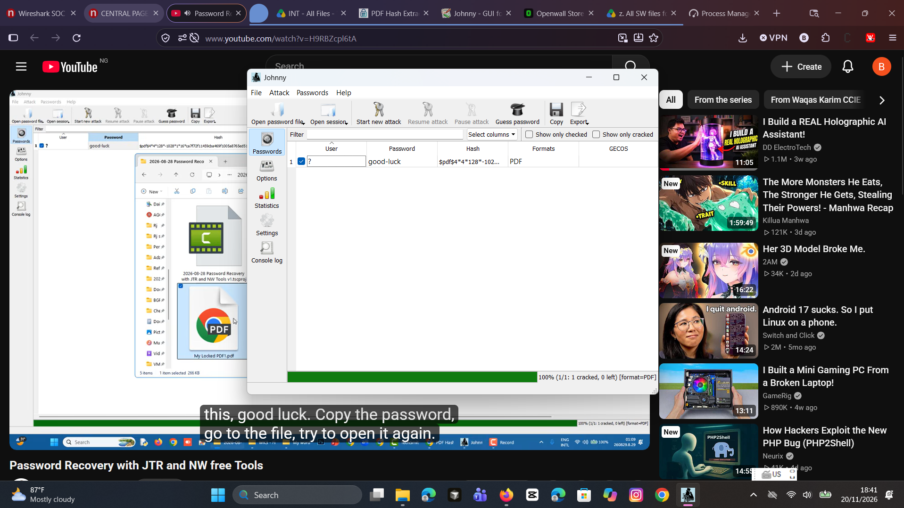
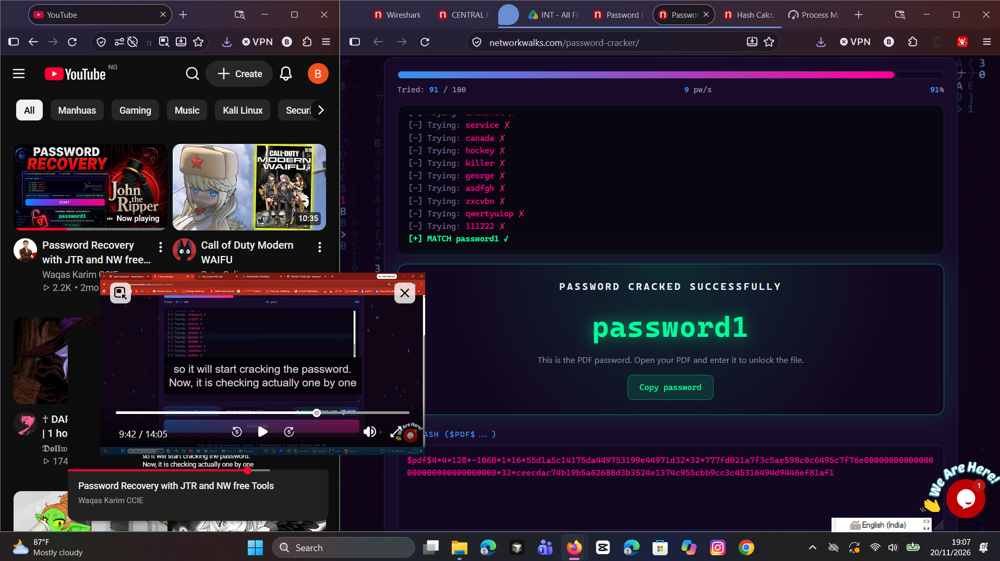
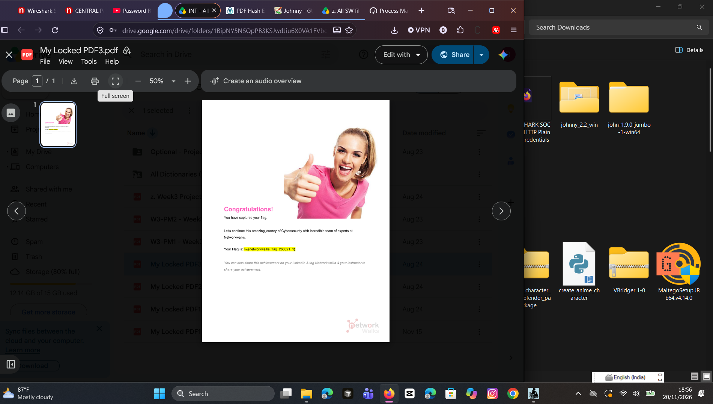

# week-3-cyber-security-netwalk-
# Week 3 Cybersecurity Internship Report

**Name:** Obi Benjamin  
**Role:** IT / Cybersecurity Intern  
**Company:** NetworkWalks  
**Week:** 3  
**Dates:**  

## 1. Executive Summary

This week focused on deepening my understanding of identity security through hands-on ethical hacking labs. I completed two structured modules on password auditing:

- One using the industry-standard John the Ripper tool
- One using NetworkWalks’ proprietary web-based tools

These exercises demonstrated how weak passwords can be compromised and reinforced the importance of strong client authentication policies.

## 2. Key Accomplishments & Tasks Completed

### A. Ethical Password Auditing with John the Ripper

Successfully completed a controlled lab exercise to recover passwords from protected files.

- Used Johnny, the graphical user interface for John the Ripper, and JTR through the command line on Windows.
- Performed a dictionary attack on a locked PDF named `My Locked PDF1.pdf`.
- Used `pdf2john` to extract the password hash and supplied it to the cracking engine.

try Tool Training: NetworkWalks Hash Calculator & Cracker

Used NetworkWalks’ internal web-based tools to perform a parallel password audit.

1. Used the Hash Calculator to extract the raw hash value from the locked PDF.
2. Used the Password Cracker to resolve the hash back to the plain-text password.

### C. Security Policy Application

- Analyzed the speed at which weak passwords were cracked in both labs.
- Documented findings to support client education on why password length and complexity are critical defenses against brute-force attacks.

## 3. Skills & Knowledge Acquired

- **Hash Extraction:** Learned how to convert protected files, such as PDF and ZIP files, into readable hash formats for analysis.
- **Tool Proficiency:** Gained hands-on experience with John the Ripper and NetworkWalks’ custom password auditing tools.
- **Attack Vectors:** Learned the mechanics of dictionary and brute-force attacks.
- **Ethical Boundaries:** Reinforced the importance of using these tools only in authorized, isolated lab environments.

## 4. Challenges Faced & Solutions Implemented

**Challenge:** Identifying the correct hash type for the PDF file was easy.

**Solution:** Used the auto-detect feature in the NetworkWalks Hash Calculator and cross-referenced the result with the John the Ripper output. This ensured that the cracking tool used the correct algorithm.

## 5. Goals for Week 3 Johnny the ripper 

## 6. Goals for Week 3 networkwalk
- Explore Active Directory Group Policy Objects used to enforce password complexity.

## 7. Feedback / Questions for Mentor

- Are there additional internal NetworkWalks tools you recommend familiarizing myself with for security auditing?
- How does NetworkWalks typically present password-cracking concepts to clients who resist changing their password habits?
